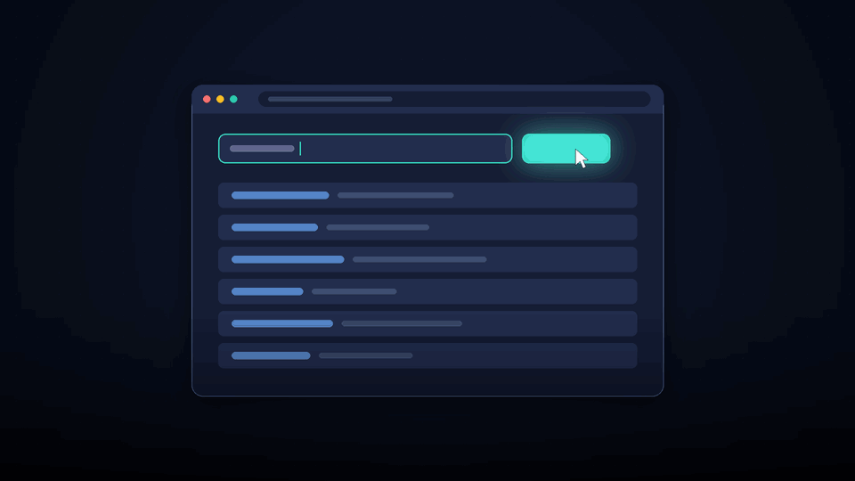
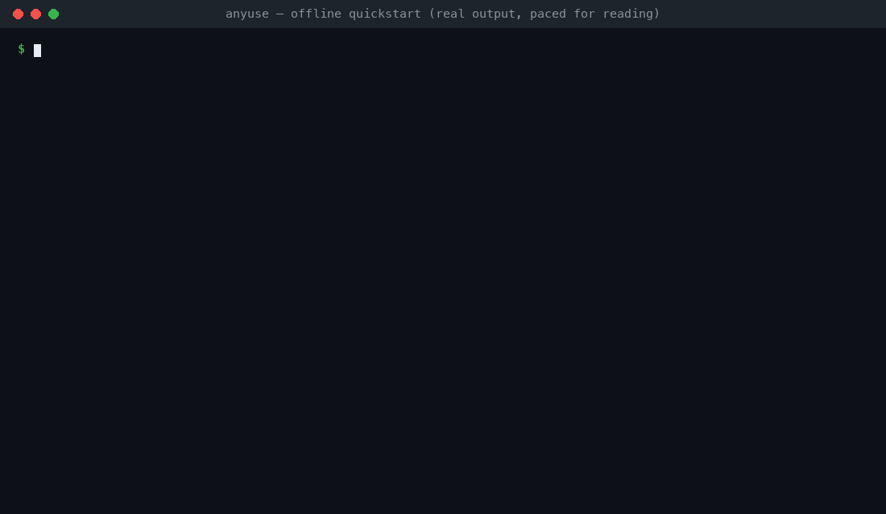

# AnyUse

**Your agent does a task once. AnyUse compiles it into a deterministic tool the agent can call again—fast, model-free, and loud when a target changes.**

A website becomes a plain HTTP request. A scriptable Mac app becomes Apple Events. A non-scriptable Mac app becomes a checked Accessibility routine. An app with no API at all becomes a reverse-engineered native call (experimental).

[Pipeline](#one-pipeline-four-targets) · [Quick start](#try-it-in-a-minute) · [Use from your agent](#use-it-from-your-agent) · [Mac & native apps](#mac-apps--native-binaries) · [Benchmarks](#what-we-measured) · [Install](#install) · [Related work](#related-work) · [Docs](docs/README.md)



## One pipeline, four targets

Every target goes through the same five steps:

1. **Capture.** You or an agent do the task once (HAR, browser attach, `anyuse learn`, macOS Accessibility watcher, or REA + Ghidra).
2. **Compile.** AnyUse extracts the cheapest deterministic way to repeat it and keeps the browser or UI replay as a fallback.
3. **Prove.** The candidate runs on held-out inputs it never saw during capture (for search: ≥8 of top 10 results in order) and learns the site's "no results" page.
4. **Serve.** `python -m anyuse.mcpserver` exposes proved tools over MCP with zero model calls on repeat runs.
5. **Heal or fail loudly.** If a target changes, AnyUse falls back (`compiled request → browser replay → agent → you`), repairs and re-proves the tool from fresh traffic, or returns an explicit failure reason—never silent empty data.

| Target | Compiles to | Status | Measured ([docs/EVIDENCE.md](https://github.com/michaelAGI/anyuse/blob/main/docs/EVIDENCE.md)) |
|---|---|---|---|
| **Websites** | Plain `GET`/`HEAD` HTTP request; browser replay fallback | **Stable** | 66.6 ms median vs. 15.8 s browser agent; 21/30 never-seen sites got a tool; 15/15 broken tools failed loudly |
| **Mac apps with scripting** (Mail, Calendar, Reminders …) | Apple Events planned from the app's `sdef` dictionary | **Beta** | 17 of 18 held-out tasks in 5 apps compiled (9 of 18 with no model) in a macOS VM |
| **Mac apps without scripting** | Recorded Accessibility (AX) routine with per-step checks | **Beta** | 12 of 15 recorded workflows proved on unseen inputs (wrong target in 6 of 90 runs) in a macOS VM |
| **Apps with no API at all** | Native call found via [REA](https://github.com/morluto/rea) + Ghidra, replayed via Frida | **Experimental** | Saved recipes replay in Flameshot, MarkText, and draw.io; cold discovery is still being validated |


## Try it in a minute

The 1-minute demo runs the web pipeline offline (Python 3.11+, no API keys, does not touch your desktop):

```sh
git clone https://github.com/michaelAGI/anyuse && cd anyuse
python3 -m venv .venv && . .venv/bin/activate
python -m pip install -e '.[mcp,registry]'
sh examples/quickstart/run.sh
```



`run.sh` starts a local search site on `127.0.0.1`, records three searches, compiles one into an HTTP tool, proves it on the other two, calls it over MCP, mutates the API so the tool self-heals without a browser or model, and deletes the data so it fails loudly. Walkthrough: [docs/QUICKSTART.md](https://github.com/michaelAGI/anyuse/blob/main/docs/QUICKSTART.md).

**Or let an agent learn a live website** (`pip install -e '.[cdp]'`, a configured model, and a container browser at `ANYUSE_LEARN_ENDPOINT`):

```sh
anyuse learn "search this site for {q}" --url https://crates.io --values serde,regex --confirm
```

On `crates.io`, the agent ran one search, AnyUse compiled `GET /api/v1/crates?q={q}` and proved it on two held-out values (32 s, 3 model calls, US$0.05); every repeat call runs with 0 model calls. Setup: [docs/QUICKSTART_COMPILE.md](https://github.com/michaelAGI/anyuse/blob/main/docs/QUICKSTART_COMPILE.md) · [docs/COMPILE.md](https://github.com/michaelAGI/anyuse/blob/main/docs/COMPILE.md).

## Use it from your agent

Install the MCP extra (`python -m pip install -e '.[mcp]'`) and register the server (`ANYUSE_MCP_PROFILE=meta` exposes all sites through four fixed tools: `list_sites`, `list_operations`, `call_operation`, `login`):

```sh
# Claude Code
claude mcp add --transport stdio --scope user anyuse --env ANYUSE_MCP_PROFILE=meta \
  -- "$PWD/.venv/bin/python" -P -m anyuse.mcpserver

# Codex
codex mcp add anyuse --env ANYUSE_MCP_PROFILE=meta -- "$PWD/.venv/bin/python" -P -m anyuse.mcpserver

# OpenClaw
openclaw mcp add anyuse --command "$PWD/.venv/bin/python" \
  --arg -P --arg -m --arg anyuse.mcpserver --env ANYUSE_MCP_PROFILE=meta
```

Export compiled tools as agent skills with `anyuse skills export ~/.claude/skills --profile meta`. Full setup (including Hermes Agent and `agent_run`): [docs/INSTALL_FOR_AGENTS.md](https://github.com/michaelAGI/anyuse/blob/main/docs/INSTALL_FOR_AGENTS.md).

## Mac apps & native binaries

**Mac apps (`pip install -e '.[desktop]'`):** Record steps once through the Accessibility tree or let computer-use learn the task once, then replay deterministically (`ANYUSE_DRIVE_ENABLED=on` required to move mouse/keyboard):

```sh
anyuse watcher start --steps                                           # do the task once, then Ctrl+C
anyuse workflow from-draft SESSION/steps_textedit_1 --name new_note --param text=@c3
ANYUSE_DRIVE_ENABLED=on anyuse workflow play new_note --param text="Hello"
```

Details: [docs/DESKTOP_TOOLS.md](https://github.com/michaelAGI/anyuse/blob/main/docs/DESKTOP_TOOLS.md).

**Apps with no API at all (experimental):** For apps with no scripting, URL scheme, or usable Accessibility tree, an agent investigates the binary once with [REA](https://github.com/morluto/rea) (`rea-agents`) and Ghidra, saves a typed recipe, and replays the internal function through AnyUse's fixed Frida bridge (Objective-C and Qt) with 0 model calls. Inspect a saved `Dictionary.app` recipe offline right from the repo:

```sh
anyuse map rea inspect examples/rea/dictionary-candidate.json --proof examples/rea/dictionary-proof.json
```

Details and current limits: [docs/REA_QUICKSTART.md](https://github.com/michaelAGI/anyuse/blob/main/docs/REA_QUICKSTART.md) · [docs/REA_ACCESS_ROUTES.md](https://github.com/michaelAGI/anyuse/blob/main/docs/REA_ACCESS_ROUTES.md).

## What we measured

Samples are small; see [docs/EVIDENCE.md](https://github.com/michaelAGI/anyuse/blob/main/docs/EVIDENCE.md) and [docs/KNOWN_ISSUES.md](https://github.com/michaelAGI/anyuse/blob/main/docs/KNOWN_ISSUES.md) for methods and caveats:

- **Speed:** **66.6 ms** median per compiled HTTP call (0 model calls) vs. **15.8 s** for the browser agent across 5 workflows.
- **Never-seen sites:** On **30 never-seen sites**, **21 got a proved tool**. Across 3 unseen inputs each (63 calls), those tools returned **46 correct** and **3 wrong** answers; 7 could not be fully checked against the page, and 7 were refused by the tool's own checks. The 9 sites without a tool handed back to the agent.
- **Silent-failure resistance:** Across 15 deliberately broken tools (3 tool types × 5 breakage modes), **15 of 15** failed loudly with zero false-empty responses.
- **Longevity:** Replayed 2–5 days later, **223 of 229** runs across 88 saved tools still worked.
- **Optional small decision models:** Where page evidence leaves a simple yes/no check open (e.g. "does this line say no results?"), AnyUse can ask a small local model instead of a large LLM: [Laya](https://huggingface.co/convaiinnovations/laya) (`pip install laya`, Apache-2.0, by Nandakishor M / Convai Innovations; [source](https://github.com/NandhaKishorM/laya); populate offline container weights + wheels with `python tools/confirmer/fetch_laya.py`) or [OpenJev](https://github.com/razorback16/openjev) ([docs/MODEL_CONFIGURATION.md](https://github.com/michaelAGI/anyuse/blob/main/docs/MODEL_CONFIGURATION.md#small-model-checks)).

## Install

From an activated Python 3.11+ virtualenv (`anyuse doctor` checks your setup without changing anything):

| Use | Install | Notes |
|---|---|---|
| Core compile & HTTP replay | `python -m pip install -e .` | Linux & macOS; read-only `GET`/`HEAD` by default |
| MCP server / offline demo | `python -m pip install -e '.[mcp,registry]'` | Exposes proved tools over stdio MCP |
| Browser `attach` & `learn` | `python -m pip install -e '.[cdp]'` | Needs Chromium DevTools (`learn` uses a container browser) |
| Mac app recording & replay | `python -m pip install -e '.[desktop]'` | macOS; needs Accessibility & Screen Recording permissions |
| Small decision model (optional) | `python -m pip install -e '.[laya]'` or `python tools/confirmer/fetch_laya.py` | [Laya](https://huggingface.co/convaiinnovations/laya) (Apache-2.0, Convai Innovations) or [OpenJev](https://github.com/razorback16/openjev) |

AnyUse respects `robots.txt` and per-host pacing ([docs/TRAFFIC_POLICY.md](https://github.com/michaelAGI/anyuse/blob/main/docs/TRAFFIC_POLICY.md)), caps daily model spend (`ANYUSE_SPEND_DAILY_USD`, default $5; [docs/SETTINGS.md](https://github.com/michaelAGI/anyuse/blob/main/docs/SETTINGS.md)), and runs locally with no telemetry ([docs/THREAT_MODEL.md](https://github.com/michaelAGI/anyuse/blob/main/docs/THREAT_MODEL.md)).

## Related work

| System | Main approach | Repeat-call cost | Held-out proof gate | When the target changes | Targets |
|---|---|---|---|---|---|
| **AnyUse** | Compiles a task done once into an HTTP request, browser replay, Apple Event, AX routine, or native call | ~66 ms, 0 model calls (optional Laya / OpenJev check) | Yes (≥8 of top 10 results in order on unseen inputs) | Repairs from page/replay traffic and re-proves, or fails loudly | Web, macOS apps, native binaries (exp.) |
| [browser-use](https://github.com/browser-use/browser-use) / [Stagehand](https://github.com/browserbase/stagehand) | LLM browser agent; Stagehand caches actions and self-heals via LLM, and [workflow-use](https://github.com/browser-use/workflow-use) records reusable workflows | Browser + LLM calls, or cached/recorded browser action | Not as a separate gate | Agent or LLM adapts to the new page | Web browser |
| [api-anything](https://github.com/goodnight000/api-anything) / [Integuru](https://github.com/Integuru-AI/Integuru) | Turns captured network traffic into HTTP operations or code | 1 HTTP request | Not as a separate gate | Re-learn / capture again | Web APIs |
| [OpenAdapt](https://github.com/OpenAdaptAI/OpenAdapt) | Records desktop GUI workflows and replays with multimodal models | GUI replay + model | Not as a separate gate | Model adapts the replay | Desktop GUI |

Our request slots and `meta` profile tool names follow [api-anything](https://github.com/goodnight000/api-anything). The native path builds on [REA](https://github.com/morluto/rea), [Ghidra](https://github.com/NationalSecurityAgency/ghidra), and [Frida](https://frida.re). Optional small-model checks use [Laya](https://huggingface.co/convaiinnovations/laya) (`pip install laya`, Apache-2.0, by Nandakishor M / Convai Innovations; [source](https://github.com/NandhaKishorM/laya)) and [OpenJev](https://github.com/razorback16/openjev).

## Status & license

Alpha ([docs/README.md](https://github.com/michaelAGI/anyuse/blob/main/docs/README.md) · [docs/KNOWN_ISSUES.md](https://github.com/michaelAGI/anyuse/blob/main/docs/KNOWN_ISSUES.md) · [SECURITY.md](https://github.com/michaelAGI/anyuse/blob/main/SECURITY.md) · [CONTRIBUTING.md](https://github.com/michaelAGI/anyuse/blob/main/CONTRIBUTING.md)). AnyUse started as a quick prototype built over a few days through long-running coding-agent sessions (Codex 6.1, Gemini 4 Argon, and Claude 5.5), steered and verified against 467 test suites ([docs/EVIDENCE.md](https://github.com/michaelAGI/anyuse/blob/main/docs/EVIDENCE.md)). The working git history was squashed for the initial public release because it contained internal research runs; ongoing development happens in public commits.

MIT ([LICENSE](https://github.com/michaelAGI/anyuse/blob/main/LICENSE)); bundled EasyList tracker extract and external tools retain their own terms ([THIRD_PARTY_NOTICES.md](https://github.com/michaelAGI/anyuse/blob/main/THIRD_PARTY_NOTICES.md)).
